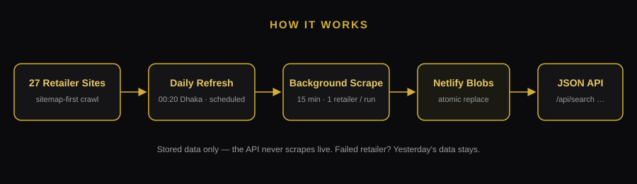

<p align="center">
  
  
  
  
  
</p>

<h1 align="center">BD PC Price API</h1>

<p align="center"><b>Unofficial scraper-backed price comparison API for Bangladeshi PC component retailers — daily scrape, Netlify Functions + Blobs, no official APIs.</b></p>

<p align="center">One search across <b>27 Bangladeshi retailers</b>. Lowest price, highest price, savings, and a link back to the retailer's own product page — refreshed once a day, served instantly.</p>

---

## What it is

Bangladesh has no public API for PC component prices. This project scrapes
**27 retailers** (Star Tech, Ryans, Techland, PCB Store, Ultra, PC House,
Sell Tech, Speed Tech, Index IT, Onix and 17 more), normalises every product
into one clean schema, and serves it as a **JSON API on Netlify** — so a
price-comparison website can search, compare and link out without scraping
anything itself.

- 🔍 **Search any part** — e.g. `Ryzen 7 5700G` → lowest / highest price, savings %, every retailer's price, and a View link to the retailer's own page.
- 💰 **Prices you can trust** — offer price + regular price, savings computed (never copied from a "Save:" label), out-of-stock prices never shown as deals.
- 🖼️ **Full product data** — name, gallery images, description, specifications, stock, and the retailer's product link.
- ⏰ **Fresh daily** — one automatic refresh a day; the API always tells you how old its data is.

> **Full API contract for the frontend:** [`API_DOCUMENTATION.md`](API_DOCUMENTATION.md) — every endpoint, parameter, response and example, written for the AI building the site.

## How it works



1. **Scheduled function** fires once a day and triggers one background job per retailer. It scrapes nothing itself (30 s limit).
2. **Background function** (15 min) scrapes one retailer — sitemap-first — validates every product and applies the price guards.
3. **Atomic replace:** new data is written to a pending key, read back and re-validated, then swapped into the live key. If a scrape fails, **yesterday's data stays** — the site never goes empty because of one bad day.
4. **API serves stored data only** — it never scrapes live, so searches answer in milliseconds.

## Endpoints

Base URL: `https://<your-site>.netlify.app`

| Endpoint | What it does |
|---|---|
| `GET /api/search?q=Ryzen%207%205700G&sort=lowest&limit=20&page=1` | Search products — lowest / highest price, savings %, paginated results |
| `GET /api/search?q=Ryzen&retailer=startech&in_stock=true` | Filter by retailer, category, or in-stock only |
| `GET /api/product?url=<product-url>` | One product by its retailer URL |
| `GET /api/retailers` | All 27 retailers, with product counts and last scrape time |
| `GET /api/stats` | Totals: products, in-stock, flagged, per retailer |
| `GET /api/status` | Data freshness: last refresh, per-retailer status, failures |

**Example — search:**

```bash
curl "https://<your-site>.netlify.app/api/search?q=Ryzen%207%205700G&sort=lowest&limit=20"
```

```json
{
  "query": "Ryzen 7 5700G",
  "count": 6,
  "lowest_price": 20000,
  "highest_price": 23400,
  "savings_pct": 14.6,
  "last_updated": "2026-11-07T18:00:00Z",
  "results": [
    {
      "retailer": "Speed Tech",
      "name": "AMD Ryzen 7 5700G Processor with Radeon Graphics",
      "price": 20000,
      "regular_price": null,
      "stock": "in_stock",
      "url": "https://www.speedtech.com.bd/amd-ryzen-7-5700g-processor"
    }
  ]
}
```

Full contract, response schema and frontend wiring code: [`API_DOCUMENTATION.md`](API_DOCUMENTATION.md).

## Retailer coverage — 27 retailers

Live-tested 2026-11-08 (full report: [`docs/LIVE_TEST_REPORT.md`](docs/LIVE_TEST_REPORT.md)).
✅ = live products scraped + price verified against the retailer's own site.
⚠️ = Cloudflare blocks plain fetch; parser verified, needs a browser-grade fetch.

| # | Retailer | Tier | Status |
|---|---|---|---|
| 1 | Star Tech | 1 | ✅ Live |
| 2 | Ryans | 1 | ⚠️ Cloudflare-blocked |
| 3 | Techland | 1 | ⚠️ Cloudflare-blocked |
| 4 | PCB Store | 1 | ✅ Live |
| 5 | Ultra Technology | 1 | ✅ Live |
| 6 | PC House BD | 1 | ✅ Live |
| 7 | Sell Tech BD | 1 | ✅ Live |
| 8 | Speed Tech | 1 | ✅ Live |
| 9 | Index IT | 1 | ✅ Live |
| 10 | Onix BD | 1 | ✅ Live |
| 11 | Computer Village | 2 | ⚠️ Cloudflare-blocked |
| 12 | Skyland Computer | 2 | ✅ Live |
| 13 | Computer Mania | 2 | ⚠️ Cloudflare-blocked |
| 14 | Nexus | 2 | ✅ Live |
| 15 | Dolphin Computers | 2 | ✅ Live |
| 16 | Creatus Computer | 2 | ✅ Live |
| 17 | Potaka IT | 2 | ✅ Live |
| 18 | Binary Logic | 2 | ✅ Live |
| 19 | Computer Source | 2 | ✅ Live |
| 20 | Flora Limited | 2 | ✅ Live |
| 21 | Global Brand PLC | 3 | ✅ Live |
| 22 | UCC BD | 3 | ✅ Live |
| 23 | Smart Technologies | 3 | ✅ Live |
| 24 | IT Source BD | 3 | ✅ Live |
| 25 | Dream Electronics BD | 4 | ✅ Live |
| 26 | Sys Computers Ltd | 4 | ✅ Live |
| 27 | AVA Technology BD | 4 | ✅ Live |

**23 live · 4 blocked.** The 4 blocked sites have working adapters and verified
parsers — only their fetch is blocked. Retailers are never invented: every
entry above was verified on its own site. Full list:
[`docs/retailers-list.md`](docs/retailers-list.md).

## Deploy on Netlify

### Option A — drag & drop (fastest)

1. Zip this folder and drop it on [app.netlify.com/drop](https://app.netlify.com/drop)
   (or push it to a Git repo and connect it — no build command needed).
2. In **Site settings → Environment variables**, set:
   - `SCRAPE_SECRET` — any long random string (protects the scrape trigger).
   - `SCRAPE_LIMIT` — optional, products per background run (default `200`).
3. Deploy. Scheduled functions only run on the **published** deploy.

### Option B — Netlify CLI

```bash
npm install
netlify link
netlify env:set SCRAPE_SECRET "a-long-random-string"
netlify deploy --prod
```

## Daily schedule

One fixed time, once a day — set in exactly one place, `netlify.toml`:

```toml
[functions."scrape-scheduled"]
  schedule = "20 18 * * *"   # 18:20 UTC = 00:20 Dhaka (test time)
```

Standing schedule for production: `"0 18 * * *"` (18:00 UTC = 00:00 midnight
Dhaka, UTC+6, no DST). Dhaka hour = UTC hour + 6.

Check a refresh: `GET /api/status` shows `last_refresh`, per-retailer status,
product counts and failures. `GET /api/stats` shows the totals.

> **Manual trigger (testing only):**
> ```bash
> curl -X POST https://<your-site>.netlify.app/.netlify/functions/scrape-background-background \
>   -H "x-scrape-secret: <redacted>" \
>   -d '{"retailer":"startech"}'
> ```
> Returns 202 immediately; the scrape continues in the background (up to 15 min).

## Price accuracy — the rules

These guards are encoded in code (`src/lib/price.js`, `src/lib/normalize.js`,
`src/lib/store.js`), not just documented:

- **Offer price wins.** Listing cards show offer first, regular second. JSON-LD /
  Open Graph is the most reliable machine source — but on Star Tech, PC House
  and Potaka IT it carries the **regular** price, not the offer. Disagreements
  are logged in `conflicts[]`, never silently picked.
- **"Save:" is never trusted.** Savings are always computed from the two prices.
- **Price 0 = no price.** Never a ৳0 deal. Savings above **80% are rejected**
  (the ৳800-shown-as-৳1,00,000 / −94% bug).
- **Out of stock ≠ a deal.** An out-of-stock product's price moves to
  `last_seen_price` and `price` becomes `null` — it can never be the cheapest.
- **Absurd prices flagged.** Over ৳1,00,000 for a non-flagship component, or
  **10×** the same model's price at other retailers, is flagged and excluded
  from lowest/highest until verified.
- **Big jumps flagged.** A price move over **50%** vs yesterday is flagged in
  `conflicts[]`, never silently accepted.

## Project layout

```
netlify.toml                  schedule + functions config
API_DOCUMENTATION.md          full API contract (for the frontend AI)
assets/banner.png             repo banner · assets/architecture.svg  flow diagram
src/lib/                      price.js · normalize.js · http.js · jsonld.js · store.js
src/scrapers/                 opencart.js (shared) + 27 retailer adapters + index.js
netlify/functions/            api.mjs · scrape-scheduled.mjs · scrape-background-background.mjs
                              scrape-live.mjs (ADMIN ONLY — the website must never call it)
scripts/run-scrape.mjs        CLI: --retailer <id|all> --limit N --dry-run
data/sample-5700g.json        verified 5700G sample (seed data for the API)
tests/                        offline fixture tests — npm test
```

### Local use

```bash
npm install
npm test                          # offline fixture tests, no network
node scripts/run-scrape.mjs --retailer startech --dry-run --limit 3
node scripts/run-scrape.mjs --retailer startech --limit 20   # live, polite
```

### Adding a retailer

1. Copy `src/scrapers/startech.js`; fill in `baseUrl`, `sitemapUrls`,
   `categoryUrls`, `crawlDelayMs` and the `isProductUrl` filter.
2. Register it in `src/scrapers/index.js`.
3. Set `ogIsRegularPrice: true` if its structured price turns out to be the
   regular price (test with a discounted product first).
4. If it shows Cloudflare challenges, set `degraded: true` and
   `browserRequired: true` — and say so in the adapter notes.

## Honest limits

- **No live prices.** The API is a daily snapshot, refreshed once a day.
  Always show `last_updated` next to a price.
- **No CSS selectors.** Adapters parse JSON-LD / Open Graph / generic text,
  so a redesign that renames a class cannot break price extraction — but a
  redesign can still break discovery, and each retailer needs a live check
  after any big change.
- **4 retailers are Cloudflare-blocked** for plain fetch (Ryans, Techland,
  Computer Village, Computer Mania). Their adapters and parsers are ready;
  they need a browser-grade fetch to go live.
- **Ultra is slow by design** — robots.txt `Crawl-Delay: 20` means ~45
  products per 15-minute run; its catalogue finishes over several daily runs.
- **Per-run cap is 200 products** per retailer (`SCRAPE_LIMIT`); catalogues
  build up over successive daily refreshes.
- Scraping public prices for comparison, with attribution and a link back to
  the retailer, is the standard price-comparison pattern — respect
  robots.txt, keep the crawl polite, and stop if a retailer asks you to.

## License

MIT — see [LICENSE](LICENSE).
